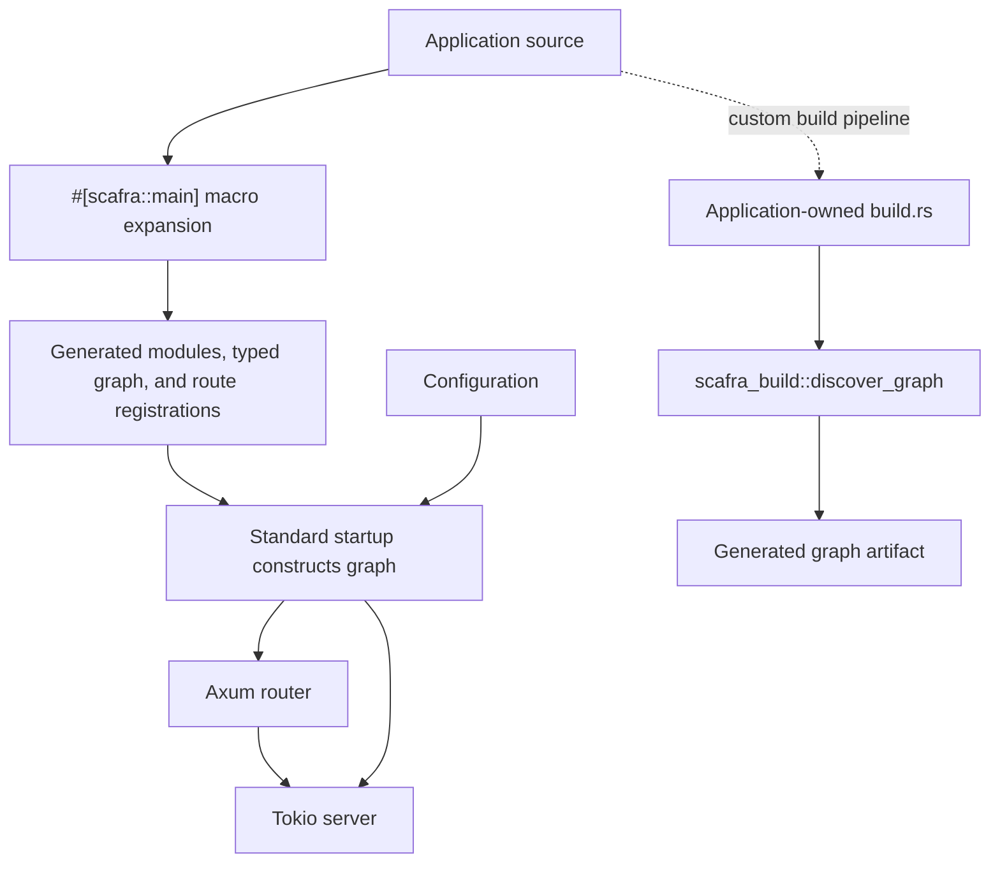
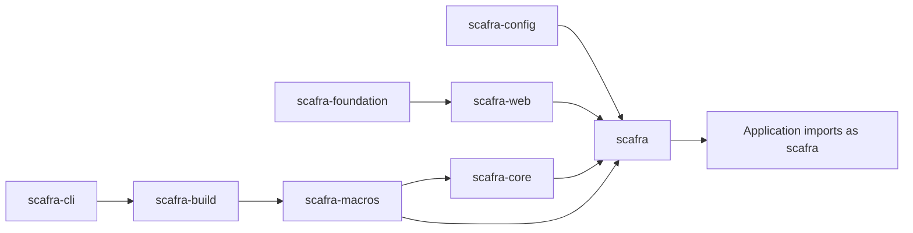

# Architecture

## Implemented modular boundaries

The facade has empty Cargo defaults and explicit technology capabilities.
Core/foundation/config support HTTP-free usage; web optionally composes security
and actuator. Foundation owns shared authorization declarations, avoiding cycles.
See [implemented module architecture](modules.md) for the authoritative feature,
lifecycle and migration contract; older composition diagrams below describe
application wiring rather than mandatory Cargo dependencies.


## Design goal

Scafra supplies the application infrastructure that is repetitive in many web
services while preserving Rust's explicit types, compiler diagnostics, and
ecosystem interoperability.

The current runtime path is:

```text
typed components
    -> generated module and route registrations
    -> application configuration and lifecycle
    -> Axum router
    -> Tokio server
```



The upper path is the standard `#[scafra::main]` flow: the macro discovers
application components and generates the typed graph during compilation, then
the generated graph constructs component instances during startup. The lower
path is optional and lets an application-owned build pipeline generate a graph
artifact with `scafra_build::discover_graph`. See the
[typed dependency graph guide](guides/dependency-graph.md) for graph behavior
and supported declarations.

## Workspace boundaries

The workspace is split into focused packages. Their published names start
with `scafra-`; dependency aliases retain the shorter crate names
used in Rust source. Framework-neutral types live in the core and foundation
packages; HTTP concerns live in the web package; configuration is handled by
the config package; project conventions are implemented by the build and CLI
packages.

This separation keeps the application facade convenient while allowing lower
layers to remain reusable and testable.



## Compile-time composition

Scafra's standard `#[scafra::main]` path discovers application components and
generates the typed dependency graph during compilation. Generated constructors
compose the graph during startup, so injected dependencies do not need
`Default`. Shared dependencies use explicit `Arc<T>` fields. A missing
dependency is diagnosed at compile time rather than through a late runtime
lookup.

Bean provider arguments are graph dependencies and are passed from the single
constructed value for each output. Provider outputs must be public structs in
application source; third-party clients and pools are returned through
application-owned newtypes. The bean macro does not synthesize `Default` or
`Bean` implementations for provider outputs.

The standard path uses static route descriptors. Scafra does not use runtime
filesystem scanning, reflection, or a global service locator. The separate
`scafra_build::discover_graph` API remains available when an application owns a
custom build pipeline; see the
[typed dependency graph guide](guides/dependency-graph.md).

## Runtime responsibilities

The standard runner owns configuration loading, logging initialization,
startup validation, route registration, listening, and graceful shutdown.
Applications can use `build_router()` or the Axum/Tower re-exports when they
need a custom server boundary. Replacing the standard runner transfers those
responsibilities to the application.

The generated graph initializes asynchronous bean providers sequentially in
the same deterministic topological order used by synchronous constructors.
Successful async resources are retained in a generated, typed resource set.
The runner requests scheduler and resource cancellation when shutdown begins,
drains HTTP requests, joins scheduler work, runs application shutdown hooks,
then awaits resource teardown in reverse dependency order. The
[resource lifecycle guide](guides/resource-lifecycle.md) documents ownership,
rollback, deadlines, cancellation limits, and a runnable example.

Scheduler callbacks remain application-scoped synchronous functions run on
Tokio's blocking pool with fixed-delay non-overlap. Their current invocation
cannot be interrupted, so scheduler shutdown may wait indefinitely for a
callback that never returns. See the [scheduler guide](guides/scheduler.md).

## Current implementation

The current implementation includes the HTTP path, project generation,
configuration, logging, optional operational endpoints, security options, and
scheduling. The standard starter uses `#[scafra::main]`; the
[typed dependency graph guide](guides/dependency-graph.md) covers its generated
graph and the optional custom build-script route.
