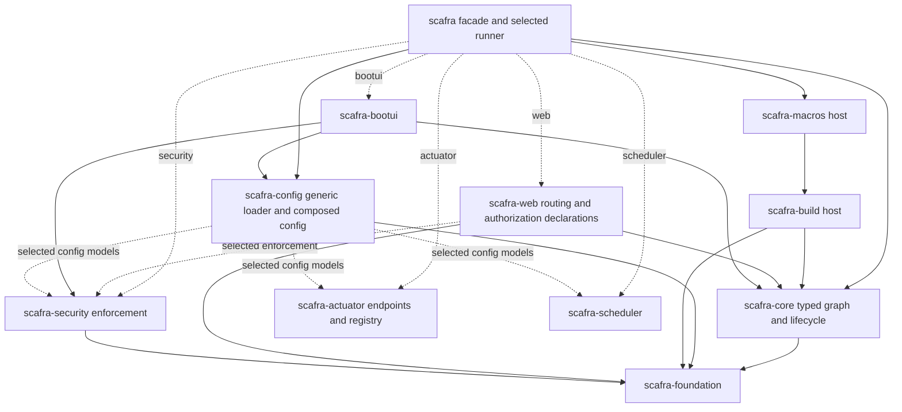

# ADR-001: Independently selectable framework capabilities

Status: **Implemented under the user's full implementation authorization; awaiting normal maintainer code review.**
Issue [#103](https://github.com/Scafra/Scafra/issues/103), target 1.0 Stable Core.
Phase 0 source evidence is based on `e041fc27c46e521e848ecbd3895d85b876c9b831`;
the subsequent implementation is uncommitted on the same branch. The final
contract and migration are in [modules](../../modules.md), with actual tests and
measurements in [implementation results](implementation.md).

## Final implementation decisions and deviations

- Retain one workspace and existing crates, empty facade/config/security/web
  defaults, opt-in technology features, and a `standard` compatibility bundle.
- Keep `ScafraConfig` in config with feature-selected fields and module-owned
  config types. This avoids a facade/BootUI cycle and preserves extension paths.
- Put neutral authorization data and inventory identity in **foundation**, rather
  than making security depend on web. Web's existing security/actuator adapters
  are optional dependency features; compatible integrated APIs remain available.
  This is simpler than moving those APIs and creates no new crate/cycle.
- Compile integration-specific environment schema adapters only with the owning
  config features. Keep one parser and existing Config/Properties trait methods;
  a new general schema registration API is unnecessary for this feature contract.
- Add explicit ConfigCapabilities narrowing to the loader and standard runner.
  Cargo may unify a dependency's extra features without selecting facade runtime
  integrations. The runner's own capabilities must therefore reject unavailable
  intent before providers/listeners, independently of dependency feature flags.
- Use facade-owned macro token adapters for optional generated graph items.
  Main/controller/routes require web; core component/config composition does not.
- JWT selects local verification and URL parsing; JWKS additionally selects the
  HTTP client and discovery. A local issuer restriction does not imply discovery.
- Preserve resource initialization/rollback/shutdown order. Reject conflicting
  authorization records and prioritize explicit HEAD policy over GET fallback.
- Verify packages via normalized archives in a staged directory registry source;
  do not claim that local staging proves actual crates.io index propagation.

The original alternatives and rationale follow. Proposal wording records design
history; the decisions above and module reference describe implemented behavior.
No commit, publish, merge, PR or issue closure is part of this task.

## Context and problem

Separate packages already exist, but the facade, configuration aggregate,
router builders, generated graph, and standard runner each assume almost all
integrations. Disabling an integration in YAML does not remove its Cargo
dependencies. Rust dead-code elimination does not measure dependency isolation
or compilation cost. See the [source audit](dependency-audit.md), exact
[Cargo inventory](cargo-inventory.md), and [baseline](baseline.md).

Core already supports framework-neutral lifecycle hooks and typed resource
traits. Preserve those contracts and the static typed graph. There is no need
for reflection, a runtime type map, filesystem discovery at runtime, or a global
service locator. Source discovery and inventory registration remain compile/link
time mechanisms.

## Options evaluated

| Criterion | A: Features over unchanged boundaries | B: Features plus corrected boundaries | C: Separate GitHub repositories |
| --- | --- | --- | --- |
| Correctness | Gating facade alone leaves config/web/generated coupling | Moves schema and policy contracts before gating | Same source problems remain across repositories |
| Security | Easy to accidentally remove metadata with middleware | Metadata survives; unavailable enforcement rejects startup | Requires identical contract work and cross-repo negative tests |
| Compile-time safety | Available if every transitive edge is also fixed; then approaches B | Typed providers and Rust signatures retained | Possible, but version drift complicates generated paths |
| Dependency isolation | Insufficient as a facade-only patch | Independent generic config, HTTP and lifecycle closures | Repository boundaries do not change Cargo closure |
| Compile time | Potential benefit only after eliminating transitive edges | Fewer selected packages expected; must measure | No intrinsic benefit relative to same package graph |
| Runtime overhead | Feature gates have no dispatch cost | Static selection; existing Tower layers only | No intrinsic difference |
| Public API | Small superficial change; deeper errors remain | Some feature-dependent fields/exports; compatibility wrappers | Same breaks plus dependency source/version migration |
| Publication | Existing packages and coordinated versions | Existing packages, topological publish order | Still topological publishing, more automation |
| Release coordination | One workspace | One workspace and tested feature contract | Multiple tags, locks, compatibility and CI coordination |
| Development | Simple initially, hard hidden coupling | Atomic local changes across crates | Cross-repo changes require staging releases/patches |
| Maintenance | Repeated cfg patches risk divergence | Explicit ownership and one lifecycle engine | More maintenance without proven independent cadence |
| Contributors | Familiar workspace; misleading isolation if incomplete | One checkout and runnable external matrix | More checkouts and setup; harder integration review |

**Propose B**, using the existing monorepo and packages. A is a useful final
manifest step after the boundary changes, not a sufficient implementation by
itself. C has no demonstrated architectural benefit for these tightly coupled
crates. Independent experimental integrations may later justify other repos.
Do not add starter-only crates or new runtime abstractions without evidence.

## Proposed dependency direction

Arrows mean “depends on”; optional edges exist only with the corresponding
capability. Do not interpret the workspace membership as a runtime dependency.



Config keeps the composed `ScafraConfig` for path compatibility, with optional
integration fields and dependencies. Generic loading with no config integration
features has no security, actuator, scheduler or Axum closure. Neutral
`ServerConfig`, `StartupConfig`, and `BootUiConfig` may remain data-only models
in config to avoid another package and a BootUI cycle. They do not initialize
an integration. Feature-dependent validation must explicitly reject unavailable
reserved sections before deserialization; absent fields alone are unsafe.

Keep module config structs and inherent validation in their current owner
crates. The aggregate adapter invokes them; do not add reverse dependencies on
`scafra-config` just to implement `Config` for a module type. Config's
`ValidationError` remains available to `Config::validation_details`.

Public authorization declarations and inventory records now live in foundation.
Both web and security re-export their shared identity. Security has no dependency
on web; web composes it only when selected. Actuator composition is likewise
optional in web. Integrated APIs retain signatures behind their capabilities;
the options API serves minimal consumers.

## Proposed facade Cargo feature contract

| Feature | Enables | Does not imply |
| --- | --- | --- |
| none / default | Core, foundation, generic config, component/config macros | HTTP, scheduler, security, actuator, BootUI |
| `web` | Web crate, HTTP runner and HTTP macro adapters | Security, JWT, JWKS, actuator, scheduler |
| `security` | `web`, enforcement, config security adapter | JWT/JWKS or operational endpoints |
| `jwt` | `security`, security's `jwt` (`jsonwebtoken`) | Remote discovery/client |
| `jwks` | `jwt`, security's `jwks` (`reqwest` and TLS) | Actuator or scheduler |
| `actuator` | `web`, actuator crate and config adapter | Application security or JWT |
| `scheduler` | Scheduler crate and config adapter | HTTP/worker runner |
| `bootui` | `web`, `security`, BootUI and config support | JWT, remote discovery or scheduler |
| `standard` | `web`, `security`, `jwt`, `jwks`, `actuator`, `scheduler` | BootUI |

Propose `default = []` for a strict opt-in facade. This changes existing bare
`scafra = "…"` applications; generated projects explicitly choose `web`.
Maintainers may prefer `default = ["web"]` for convenience, but then core
consumers must always disable defaults. Do not change the proposal silently:
update the default row of the external fixture and migration guide together.
`standard` preserves the old runtime capability set; BootUI was already a
separate explicit dependency and remains outside it.

Within `scafra-config`, propose internal `security`, `actuator`, `scheduler`,
and `bootui` composition features (plus a temporary `standard` compatibility
bundle during staged implementation). No-feature generic config must stay
independent. Within security, `default = []`, `jwt = ["dep:jsonwebtoken"]`,
`jwks = ["jwt", "dep:reqwest"]`; adapt URL validation so Basic/static bearer
does not retain reqwest just for URL parsing. Reuse an existing parser if
needed; do not implement a home-grown URL security parser.

Facade dependencies use `optional = true`, `dep:…`, and explicit forwarding;
do not accidentally activate a subcrate's compatibility default features.
Features are additive and unified. A caller's `default-features = false`
cannot undo another dependency enabling `standard` or `jwks`. Direct
`scafra-core` and `scafra-config` consumers have stronger isolation because
their package graphs have no facade edge; still inspect their unified features.
No mutually exclusive features or feature-selected authentication bypasses.

Illustrative **future** application manifests (version `1` is the target):

```toml
# 1. Minimal REST API
[dependencies]
scafra = { version = "1", default-features = false, features = ["web"] }
```

```toml
# 2. Protected REST API: Basic/static bearer; add jwt or jwks explicitly
[dependencies]
scafra = { version = "1", default-features = false, features = ["security"] }
```

```toml
# 3. API with health checks; configure endpoint exposure explicitly
[dependencies]
scafra = { version = "1", default-features = false, features = ["web", "actuator"] }
```

```toml
# 4. Scheduler/core capability consumer, no standard HTTP main entrypoint
[dependencies]
scafra = { version = "1", default-features = false, features = ["scheduler"] }
# A core-only user can instead depend on scafra-core = "1".
```

```toml
# 5. Full standard application
[dependencies]
scafra = { version = "1", default-features = false, features = ["standard"] }
# Add "bootui" only for the optional operations dashboard.
```

## Configuration and fail-closed composition

Use one loader and its existing deterministic precedence. Add explicit,
compile-time supplied schema metadata for deserialization-only secrets and
dynamic maps, replacing `sources.rs`'s knowledge of JWT and scheduled tasks.
Preserve existing generic `load`/`Properties` methods with default metadata
and add an explicit schema-aware path for the aggregate; do not require every
application `Config` implementation to implement a new required method.
Config derive and module adapters supply schema additions. No runtime plugin
registry is needed.

After selecting sources/profiles, enforce supported reserved namespaces over
the resolved document and selected inputs. If an omitted reserved capability
has any explicit configuration section, including `enabled: false`, reject it
with the capability name and safe migration advice. This strict policy avoids
guessing whether settings were intended to protect the app. Absent sections
are valid. Reject misspelled keys inside framework-owned sections; application
properties outside those sections remain allowed. Do not globally apply
`deny_unknown_fields` to all application files. Inspect selected input keys
before merge so an unavailable security section cannot disappear through an
override to null. Preserve #75 source failures and #78 schema-based environment
path resolution; an environment value must not broaden its schema.

Authorization declarations always compile with web. Explicit protection with
no security implementation fails at router construction before serving; macro
attributes may additionally produce an actionable compile error. Validate
effective controller/route policy, role groups, scopes and handwritten metadata.
Never discard metadata under a security cfg. Security enabled without valid
credentials, JWT selected in config without JWT code, and remote URI config
without JWKS code all reject startup. Never fall back from failed JWT to a
static bearer check. Actuator keeps its own token policy independently of
application security.

## Macros, runners and lifecycle

Keep service/bean/config expansion core-only. Split graph rendering into core
composition/resource ownership and HTTP adapter fragments. Generated optional
fragments must be selected by the **compiled facade**, not
`#[cfg(feature = "web")]` in the application's feature namespace or ambient
environment checks inside a proc macro. One concrete mechanism is hidden
facade-exported `macro_rules!` token adapters with feature-selected definitions:
the web adapter expands HTTP items only in a web build; a required-web adapter
emits a clear compile error when main/controller is used without web. The build
renderer wraps HTTP methods in those adapters. Test this through external
consumers before making it a compatibility contract. Avoid relying on
proc-macro host-feature unification to infer consumer capabilities.

`#[scafra::main]` retains its HTTP behavior when web is selected. Core and
scheduler-only consumers compose lifecycle themselves; a supervised worker
entrypoint remains [#49](https://github.com/Scafra/Scafra/issues/49).
Do not manufacture a second lifecycle owner. Preserve async initialization
order, reverse completed-resource rollback, retained Arc ownership,
cooperative cancellation, HTTP drain, scheduler drain, hook shutdown, resource
shutdown and original-error precedence. Extension startup receives the already
validated effective config/profile after bind. BootUI currently spawns a
detached listener; do not silently claim it participates in resource shutdown.

## Compatibility policy and approval gates

See [compatibility and security review](compatibility-security.md) and
[implementation packages](roadmap.md). Preserve root/prelude paths under their
selected features; retain `__private` generated paths and error categories.
Feature-dependent struct fields and enum variants affect source compatibility
and exhaustive matches and must be documented before 1.0. Existing applications
can initially select `standard`. Direct config users select matching module
features; direct web/security builder users may need new facade adapters.

[#82](https://github.com/Scafra/Scafra/issues/82) is source-file organization
with unchanged APIs. It can land separately; keep root re-exports and avoid
combining its file moves with dependency surgery.

The user authorized all implementation phases. Defaults, feature-dependent
aggregate fields, strict unavailable-section rejection, shared declaration
ownership and generated adapters are implemented and documented for code review.
Maintainers retain release/API review responsibility; issue #103 is not closed
and no public release has been made. Performance results are observations,
not guaranteed improvements.
