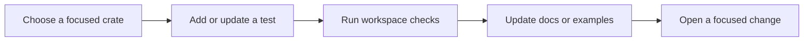

# Contributing

## Isolated capability checks

Workspace all-features checks are supplemented by external consumers:
`python3 scripts/arch103-consumers.py /var/tmp/consumers-NEW --runtime` and
`python3 scripts/arch103-negative.py --output /var/tmp/negatives-NEW`.
Populate the cache first with `cargo fetch --locked`. Use `TMPDIR=/var/tmp`
when running the full test suite on machines with a small tmpfs. See
[module verification](modules.md#cli-and-verification).


Scafra is a modular Rust workspace. Contributions are welcome in code,
documentation, tests, examples, diagnostics, and generated starter templates.

## Before opening a change

Read the [architecture guide](architecture.md) and identify the smallest crate
that owns the behavior. Prefer a focused change with a test or documentation
example that demonstrates the intended behavior.



## Local checks

Run the checks that match your change, and preferably the full workspace suite:

```bash
cargo fmt --all -- --check
cargo check --workspace
cargo clippy --workspace --all-targets --all-features -- -D warnings
cargo test --workspace --all-features
```

For CLI or generated-project changes, also run the relevant `scafra new`,
`scafra check`, or generated-project integration tests.

## Contribution principles

- Prefer ordinary Rust types and compiler-checked behavior.
- Keep generated code readable and inspectable.
- Avoid adding runtime reflection, global mutable containers, or string-key
  dependency lookup as the primary architecture.
- Keep public APIs small and document the user-facing behavior.
- Add regression tests for diagnostics, configuration precedence, generated
  files, and lifecycle behavior when those areas change.

## Compatibility review checklist

Apply the [API policy](api-stability.md) to each PR touching a public contract.
Private implementation-only fixes do not need an ADR. A breaking change needs
an explicit maintainer version/scope decision recorded in the PR before merge.

- [ ] Identify changed public paths, fields, variants, trait/associated items,
  bounds, re-exports and observable behavior; classify additions in the inventory.
  Compare with the previous supported release under minimal and enabled features.
- [ ] Choose patch/minor/major (0.x: patch/next minor) using the policy matrix.
  Review coherence, inference, method resolution and exhaustive construction.
- [ ] Check Cargo defaults, dependency closure, feature forwarding and unions;
  run `python3 scripts/check-api-policy.py` and its drift tests.
- [ ] Check configuration keys, precedence, defaults, errors and validation;
  never make unavailable security intent silently disappear.
- [ ] Review supported macro input **and generated APIs**, hidden runtime paths,
  dependency lower bounds and version-only external consumer resolution.
- [ ] Check Rust 1.88 dependency/source compatibility, target-specific behavior
  and existing CI coverage. Record any tooling-only compiler exception.
- [ ] Preserve authentication/authorization, route composition, operational
  guards, redaction, initialization/rollback and shutdown invariants with
  negative/runtime regression tests as appropriate.
- [ ] Include a written rationale and before/after migration example for every
  break; update policy/inventory, relevant guides and release notes. If an API
  is actually deprecated, document its replacement and intended removal line.
- [ ] Attach commands/results for workspace, MSRV, external/negative consumers,
  generated apps and package checks as relevant; do not infer package success
  from a path build. Breaking releases require the full policy release gates.
- [ ] Record maintainer approval of product-level compatibility changes.

An ADR is required for changing the compatibility model, crate ownership or
versioning, default feature philosophy, supported lifecycle/security semantics,
or MSRV/target support policy. Extend an existing ADR for a closely related
change. An ordinary compatible addition or a documented mechanical rename in
an already approved major migration needs the checklist and rationale, not a
separate ADR for each item. Hosted CI and release approval remain separate
from local implementation review.
